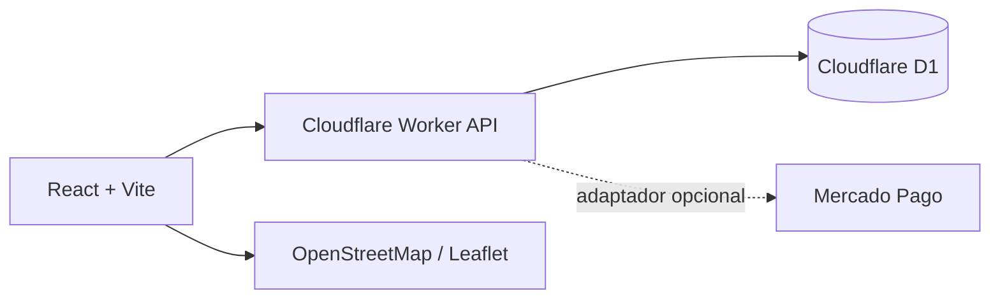

# Lumbre Café


Una experiencia e-commerce full-stack para una marca argentina ficticia de café de especialidad. El proyecto combina dirección de arte editorial, narrativa de producto, animación y un flujo de compra demostrable sobre una arquitectura preparada para Cloudflare.

[Ver demo](https://lumbre-cafe.odriozolageronimo.workers.dev) · [Leer el caso de estudio](https://lumbre-cafe.odriozolageronimo.workers.dev/proyecto)

> La marca y el catálogo son conceptuales. El checkout usa un entorno de demostración y no procesa cobros reales sin credenciales externas configuradas.

## Qué incluye

- Landing inmersiva, mobile-first y completamente responsive.
- Tres cafés de origen con identidad visual, transiciones y piezas audiovisuales propias.
- Catálogo, carrito persistente durante la sesión y cálculo orientativo de envío por código postal.
- Checkout sandbox con estados de aprobación, rechazo y reintento.
- Adaptador opcional para Mercado Pago, webhook firmado e idempotencia de eventos.
- API ejecutada en Cloudflare Worker y persistencia en D1 mediante Drizzle ORM.
- Panel de operaciones protegido para consultar pedidos y actualizar estados.
- Rate limiting nativo en Cloudflare, validación de origen, comparación segura de credenciales y honeypot antispam.
- Metadatos SEO, sitemap, robots, JSON-LD, accesibilidad y soporte para movimiento reducido.
- Presupuesto automatizado de rendimiento para JavaScript, CSS e imagen principal.
- Caso de estudio integrado para presentar decisiones de diseño y arquitectura en portfolio.

## Stack

React · TypeScript · Vite · Framer Motion · Leaflet · Cloudflare Workers · D1 · Drizzle ORM

## Arquitectura



El frontend y la API se sirven desde el mismo origen. Si no se configuran credenciales de Mercado Pago, la aplicación activa automáticamente el checkout sandbox; de ese modo todo el recorrido puede evaluarse sin dependencias privadas.

## Rutas principales

| Ruta | Función |
| --- | --- |
| `/` | Experiencia de marca, productos, ritual y tienda |
| `/proyecto` | Caso de estudio del proyecto |
| `/admin` | Panel protegido de operaciones |
| `/api/catalog` | Catálogo público |
| `/api/shipping/quote` | Cotización orientativa de envío |
| `/api/orders` | Creación de pedidos |
| `/api/payments/session` | Inicio del pago real o sandbox |
| `/api/payments/mercadopago/webhook` | Recepción validada de notificaciones |

## Desarrollo local

Requisitos: Node.js 22 o superior y npm.

```bash
npm ci
npm run dev
```

Para compilar el frontend, empaquetar el Worker y ejecutar la suite de integración:

```bash
npm run check
```

## Variables de entorno

Copiá `.env.example` a `.env` únicamente para desarrollo local:

```env
ADMIN_ACCESS_KEY=una-clave-larga-de-desarrollo
MERCADO_PAGO_ACCESS_TOKEN=TEST-tu-token-de-prueba
MERCADO_PAGO_WEBHOOK_SECRET=tu-secreto-de-webhook
```

No uses credenciales de producción en un clon público. Sin las variables de Mercado Pago, el sitio conserva toda la experiencia mediante el simulador integrado.

## Base de datos

El esquema está en `db/schema.ts` y las migraciones versionadas en `drizzle/`. La aplicación espera un binding D1 llamado `DB`.

```bash
npm run db:generate
```

## Despliegue

La demo está publicada como una aplicación de Cloudflare Worker + D1. Para un despliegue propio se necesitan:

1. Un proyecto de Cloudflare y una base D1 enlazada como `DB`.
2. Los secretos de runtime cargados en el proveedor, nunca incluidos en Git.
3. `npm run build` como paso de compilación.
4. `dist/server/index.js` como Worker generado y `dist/client` como assets estáticos.

El workflow de GitHub Actions valida cada push y pull request. No publica automáticamente: el despliegue queda desacoplado para no exponer credenciales ni reemplazar un entorno existente por accidente.

## Autoría y uso

Diseño y desarrollo por [Gerodrix](https://github.com/Gerodrix). Proyecto de portfolio distribuido bajo licencia MIT.

## Contribuir

Ver [CONTRIBUTING.md](CONTRIBUTING.md).
